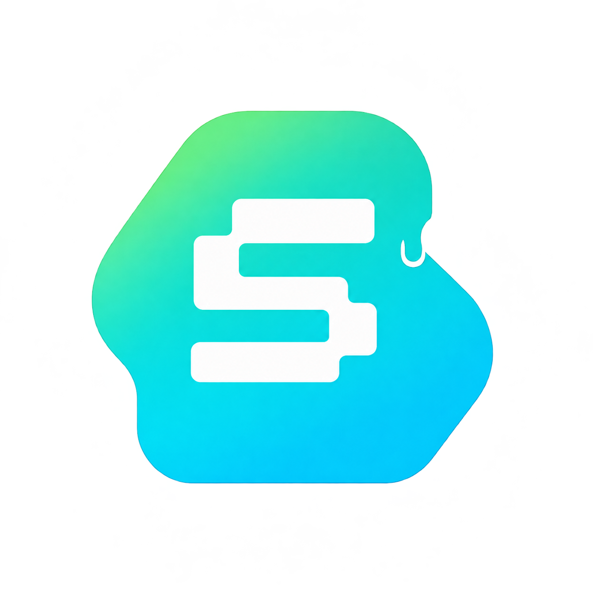
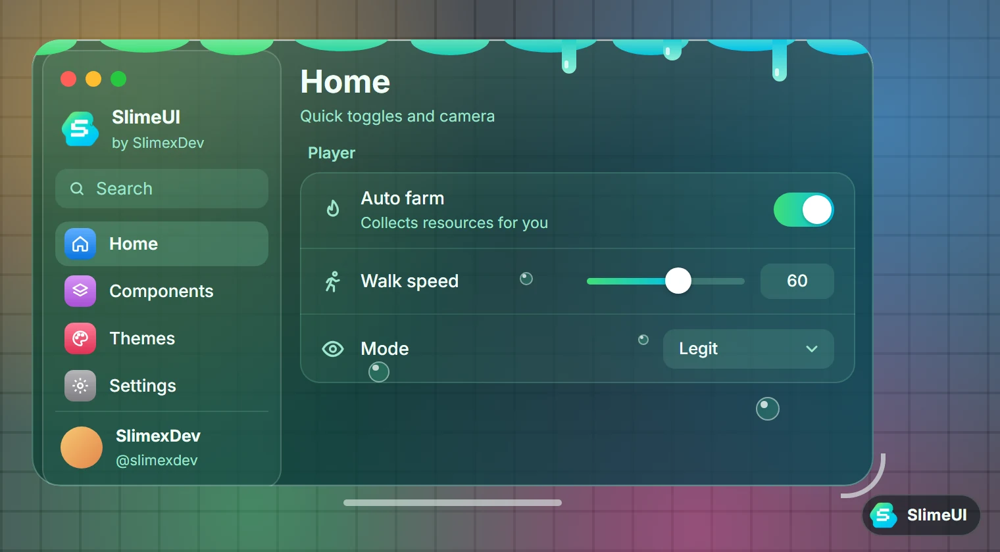
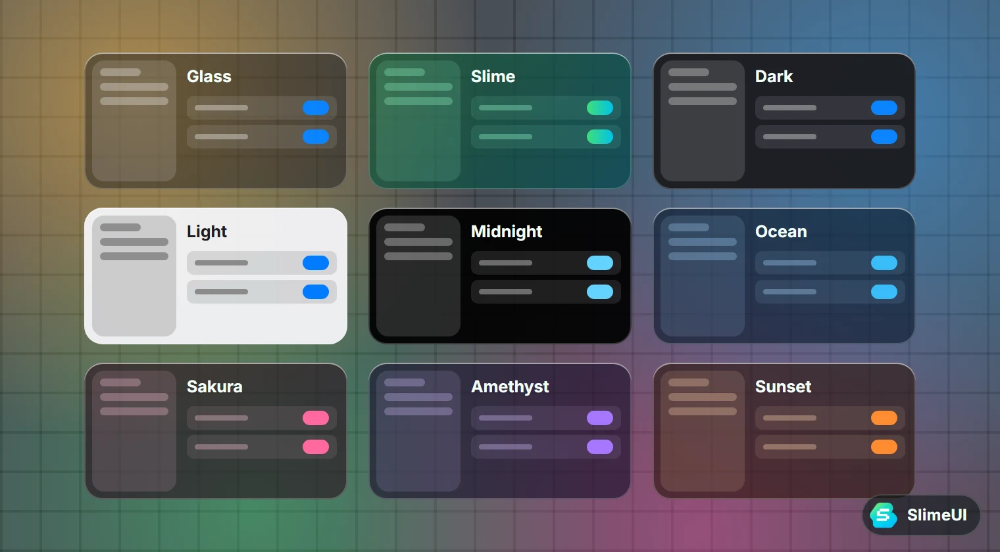
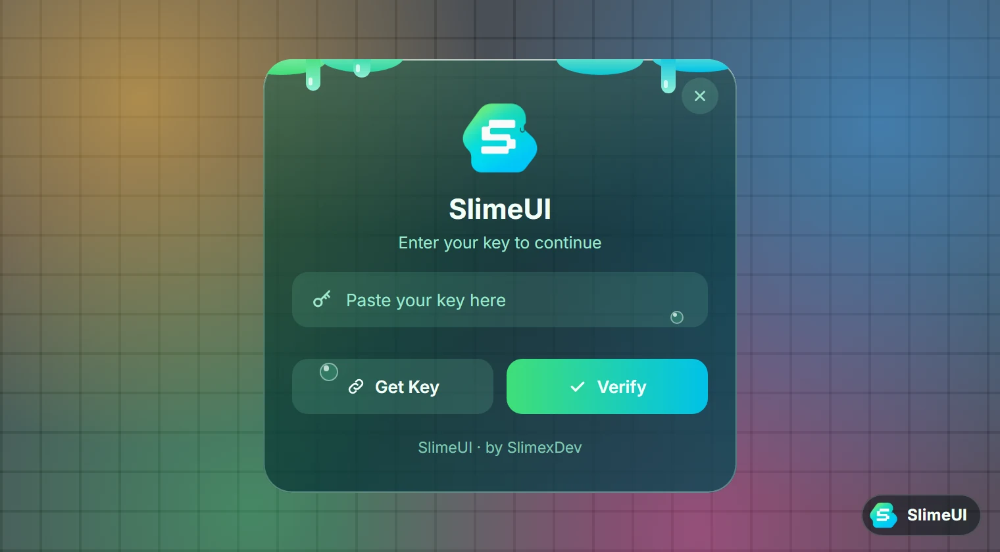
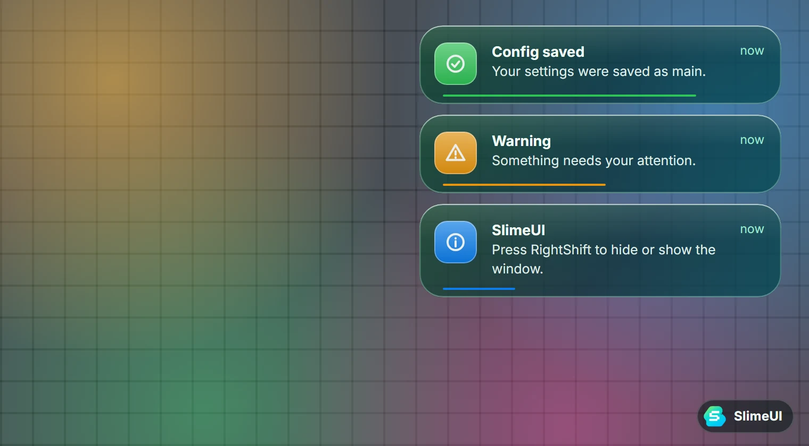
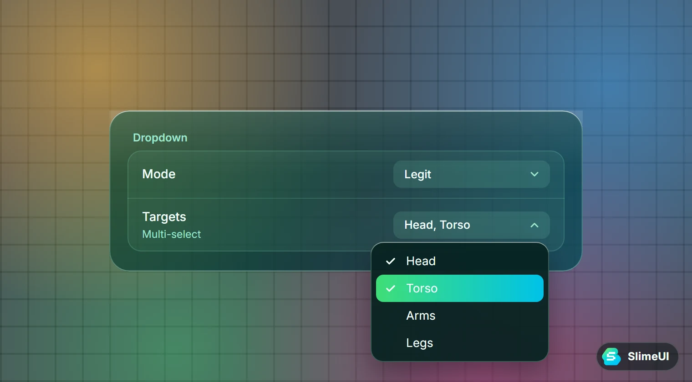

<p align="center">
  
</p>

<h1 align="center">SlimeUI</h1>

<p align="center">
  <a href="https://slimexdev.github.io/SlimeUI/"><b>Documentation</b></a> ·
  <a href="examples/Example.lua">Example</a> ·
  <a href="https://github.com/SlimexDev/SlimeUI/releases/latest">Latest release</a> ·
  <a href="LICENSE">MIT License</a>
</p>

<p align="center">
  
</p>

SlimeUI is a UI library for Roblox scripts. You build a full script hub (tabs, toggles, sliders, dropdowns, keybinds, notifications, a key system and saved configs) in a few lines of Lua, and it looks good on both PC and mobile.

## Why SlimeUI

- **Polished look.** Translucent windows, glowing edges, and smooth animations on every control.
- **Simple API.** Each element is one line, or a table when you need more options. No setup beyond `CreateWindow`.
- **9 themes, plus your own.** `Glass`, `Slime`, `Dark`, `Light`, `Midnight`, `Ocean`, `Sakura`, `Amethyst` and `Sunset`, switchable at runtime. Add your own with `SlimeUI:AddTheme`.
- **The Slime theme.** Green-to-cyan glass with a wavy slime coat on the top edge, dripping slime, glossy rising bubbles and a jelly bounce.
- **Built-in essentials.** Key system, notifications, a Settings tab, flag-based config saving, and 818 Lucide icons by name.
- **Window controls that feel native.** Collapse into a glass bar at the top of the screen, resize from the corner arc, move from the bar underneath.
- **Mobile ready.** Compact layout on small or touch screens, plus a draggable floating toggle button.

<table>
  <tr>
    <td></td>
    <td></td>
  </tr>
  <tr>
    <td></td>
    <td></td>
  </tr>
</table>

## Installation

```lua
local SlimeUI = loadstring(game:HttpGet("https://raw.githubusercontent.com/SlimexDev/SlimeUI/main/dist/SlimeUI.lua"))()
```

Or pin to the latest release:

```lua
local SlimeUI = loadstring(game:HttpGet("https://github.com/SlimexDev/SlimeUI/releases/latest/download/SlimeUI.lua"))()
```

## Quick start

```lua
local Window = SlimeUI:CreateWindow({
    Title = "My Hub",
    Subtitle = "by Me",
    Theme = "Slime",
})

local Main = Window:Tab("Main", "home", "Everyday features")

Main:Section("Player")
Main:Toggle("Auto farm", false, function(on)
    print("Auto farm:", on)
end)
Main:Slider("Walk speed", 16, 100, 16, function(value)
    print("Speed:", value)
end)
Main:Dropdown("Mode", { "Legit", "Rage" }, "Legit", function(mode)
    print("Mode:", mode)
end)
Main:Button("Say hi", function()
    Window:Notify("Hi", "Hello from SlimeUI", 3)
end)
```

Press `RightShift` to hide or show the window.

## Elements

| Element | Short form |
| --- | --- |
| Toggle | `Tab:Toggle(name, default, callback)` |
| Slider | `Tab:Slider(name, min, max, default, callback)` |
| Button | `Tab:Button(name, callback)` |
| Dropdown | `Tab:Dropdown(name, options, default, callback)` |
| Segmented | `Tab:Segmented(name, options, default, callback)` |
| Keybind | `Tab:Keybind(name, key, callback)` |
| Input | `Tab:Input(name, placeholder, callback)` |
| Label | `Tab:Label(text)` |
| Paragraph | `Tab:Paragraph(title, content)` |

Every element also accepts a table with extra options such as `Description`, `Icon` and `Flag`. See the [documentation](https://slimexdev.github.io/SlimeUI/) for all options, window methods, the key system, themes and configs.

## Project layout

```
src/            source modules (edit these)
  order.txt     build order
dist/           built single file (SlimeUI.lua)
build/          build script
docs/           documentation site (GitHub Pages)
examples/       example scripts
assets/         logos (logo.png is the one loaded in game)
tools/shots/    docs illustrations, render with python tools/shots/render.py
dev.lua         run straight from src/ without building
```

## Building from source

Requires Python 3.

```bash
python build/build.py
```

This joins the files in `src/` (in the order of `src/order.txt`) into `dist/SlimeUI.lua`. Commit the updated `dist/` file together with your source changes; the Build workflow fails if they are out of sync.

Pushing a tag such as `v1.0.1` creates a GitHub release with `SlimeUI.lua` attached.

## Credits

- Design and code: **SlimexDev**
- Icons: [Lucide](https://lucide.dev) (ISC License); asset ID table from [Fluent](https://github.com/dawid-scripts/Fluent) (MIT)
- Project layout inspired by [WindUI](https://github.com/Footagesus/WindUI)

SlimeUI is released under the [MIT License](LICENSE).
